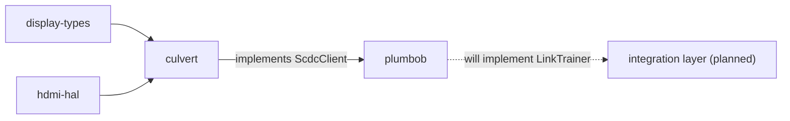

# culvert

[](https://github.com/ashlar-display/culvert/actions/workflows/ci.yml)
[](https://crates.io/crates/culvert)
[](https://docs.rs/culvert)
[](LICENSE)
[](https://blog.rust-lang.org/2025/02/20/Rust-1.85.0.html)
[](https://slsa.dev)
[](#verifying-releases)

> **Part of [Ashlar](https://ashlar-display.org)** — a display connection stack in Rust,
> HDMI 2.1 first: from EDID parsing through mode negotiation to FRL link training.
>
> [display-types](https://github.com/ashlar-display/display-types) ·
> [piaf](https://github.com/ashlar-display/piaf) ·
> [concordance](https://github.com/ashlar-display/concordance) ·
> [cartouche](https://github.com/ashlar-display/cartouche) ·
> **culvert** ·
> [plumbob](https://github.com/ashlar-display/plumbob) ·
> [hdmi-hal](https://github.com/ashlar-display/hdmi-hal) ·
> [hdmi-hal-i2c-dev](https://github.com/ashlar-display/hdmi-hal-i2c-dev)

Typed access to the HDMI 2.1 SCDC register map.

`culvert` sits on top of [`hdmi_hal::scdc::ScdcTransport`] and gives raw SCDC register
bytes meaning: named structs, typed enums, and one method per register group for
scrambling control, FRL training primitives, version negotiation, update flags, and
Character Error Detection. It is the SCDC layer that [`plumbob`]'s link training state
machine drives, and is equally usable without it.

Sequencing of register operations — rate selection, timeout handling, retry logic — is
out of scope. Culvert provides the typed primitives; the caller decides when to call them.

## Usage

```sh
cargo add culvert
```

Wrap your transport in `Scdc` and call typed methods:

```rust
use culvert::{Scdc, TmdsConfig, FrlConfig, FrlRate, FfeLevels, ClearableUpdateFlags};

let mut scdc = Scdc::new(transport);

// Version negotiation
let sink_ver = scdc.read_sink_version()?;
scdc.write_source_version(1)?;

// Enable TMDS scrambling
scdc.write_tmds_config(TmdsConfig {
    scrambling_enable: true,
    high_tmds_clock_ratio: true,
})?;

// Wait for the sink to be ready, then request an FRL rate
let flags = scdc.read_status_flags()?;
if flags.flt_ready {
    scdc.write_frl_config(FrlConfig::new(
        FrlRate::Rate12Gbps4Lanes,
        FfeLevels::new(3).unwrap(),
    ))?;
}

// On FLT_Update, read the pattern each lane requests, then acknowledge the flag
let updates = scdc.read_update_flags()?;
if updates.flt_update {
    let requests = scdc.read_ltp_requests()?;
    scdc.clear_update_flags(ClearableUpdateFlags::new(false, false, false, false, true, false))?;
    if requests.all_trained() {
        // training passed; wait for FRL_Start in the update flags
    }
}

// Read per-lane character error counts, the CED block in one read, checksum checked
let reading = scdc.read_ced(FrlRate::Rate12Gbps4Lanes.lanes())?;
for warning in reading.iter_warnings() {
    // e.g. a checksum mismatch: the counts may be torn; read again or distrust them
    println!("CED warning: {warning:?}");
}
if let Some(count) = reading.counters.lane0 {
    println!("lane 0 errors: {}", count.value());
}
```

To use culvert as the SCDC backend for `plumbob`'s link training state machine, enable
the `plumbob` feature:

```sh
cargo add culvert --features plumbob
cargo add plumbob
```

`Scdc<T>` then implements `plumbob::ScdcClient`, one culvert method per training
operation. `Scdc` does not wait between calls: plumbob polls `FLT_ready` and `Update_0`
in loops whose limits assume one poll every 2 ms, so wait that interval in the two polled
methods, in an `ScdcClient` that wraps `Scdc<T>`, and put a deadline there too, not in
the transport; [`doc/architecture.md`](doc/architecture.md) shows how.

## Register coverage

| Register group            | Addresses   | Methods |
|---------------------------|-------------|---------|
| Version                   | 0x01–0x02   | `read_sink_version`, `write_source_version` |
| Update flags              | 0x10        | `read_update_flags`, `clear_update_flags` |
| TMDS / scrambling         | 0x20–0x21   | `write_tmds_config`, `read_scrambler_status` |
| FRL config                | 0x30–0x31   | `write_config_0`, `write_frl_config` |
| Source test configuration | 0x35        | `read_source_test_config` |
| Status flags              | 0x40        | `read_status_flags` |
| LTP requests              | 0x41–0x42   | `read_ltp_requests` |
| Character Error Detection | 0x50–0x58 (checksum at 0x56) | `read_ced` |
| RS correction count       | 0x59–0x5A   | `read_rs_correction` |

The register map and its sources are described in
[`doc/architecture.md`](doc/architecture.md#the-scdc-register-map). Registers not yet
covered (manufacturer identification, among others) are documented in
[`doc/roadmap.md`](doc/roadmap.md).

## Features

| Feature   | Default | Description |
|-----------|---------|-------------|
| `plumbob` | no      | Implements `plumbob::ScdcClient` for `Scdc<T>` |

## `no_std`

`culvert` is `#![no_std]` throughout. All output types are stack-allocated; no allocator
is required in any configuration.

## Stack position



`culvert` does not depend on `plumbob`. The relationship runs the other way: enabling the
`plumbob` feature makes `Scdc<T>` implement `plumbob::ScdcClient`, and any crate that
implements `ScdcClient` is substitutable.

## Out of scope

- **Async API** — the async client is the separate `culvert-async` crate. Both clients
  use the I/O-free `culvert::codec` module (register addresses and per-register encoding
  and decoding), so the register map exists once.
- **Link training state machine** — the sequencing of FRL training (rate selection,
  polling, fallback to TMDS) belongs in the link training crate. Culvert provides the
  register operations; the state machine decides when to call them.
- **PHY configuration** — `HdmiPhy` operations are the link training layer's concern.
- **I²C / DDC transport** — platform backends implement `ScdcTransport` from `hdmi-hal`.
  Culvert never touches I²C directly.

## Documentation

- [`doc/setup.md`](doc/setup.md) — build, test, and coverage commands
- [`doc/testing.md`](doc/testing.md) — testing strategy, transport harness, and CI expectations
- [`doc/architecture.md`](doc/architecture.md) — role, scope, register map, type
  reference, design principles, and the culvert / link training boundary
- [`doc/roadmap.md`](doc/roadmap.md) — SCDC registers deferred to future releases

## Verifying releases

Releases are built on GitHub Actions and attested with
[SLSA Build Level 2](https://slsa.dev) provenance (from 0.2.0). To verify a release
`.crate` against its signed provenance, install the
[GitHub CLI](https://cli.github.com/) and run:

```sh
gh attestation verify culvert-X.Y.Z.crate --repo ashlar-display/culvert
```

The release from before the repository moved to the `ashlar-display` organization (0.2.0)
was attested under its previous owner, and verifies against it:

```sh
gh attestation verify culvert-0.2.0.crate --owner DracoWhitefire \
  --signer-repo DracoWhitefire/culvert
```

The attested `.crate` is attached to each
[GitHub release](https://github.com/ashlar-display/culvert/releases).

Releases from 0.2.0 are uploaded through crates.io
[trusted publishing](https://rust-lang.github.io/rfcs/3691-trusted-publishing-cratesio.html): the publish
workflow obtains a short-lived token via OpenID Connect instead of using a stored
API token. crates.io can also reject uploads made with an API token for this crate;
the badge above shows whether that setting is on. Each version's publishing details,
including the workflow run and commit, are available from the crates.io API:

```sh
curl -A "your-tool (contact)" https://crates.io/api/v1/crates/culvert/X.Y.Z
# see .version.trustpub_data
```

Versions up to 0.1.2 were uploaded with an API token (0.1.0 by hand, 0.1.1 and 0.1.2
from CI). They carry no provenance and have no GitHub release.

## License

Licensed under the [Mozilla Public License 2.0](LICENSE).
